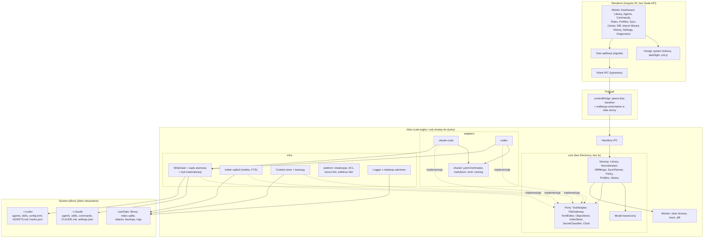
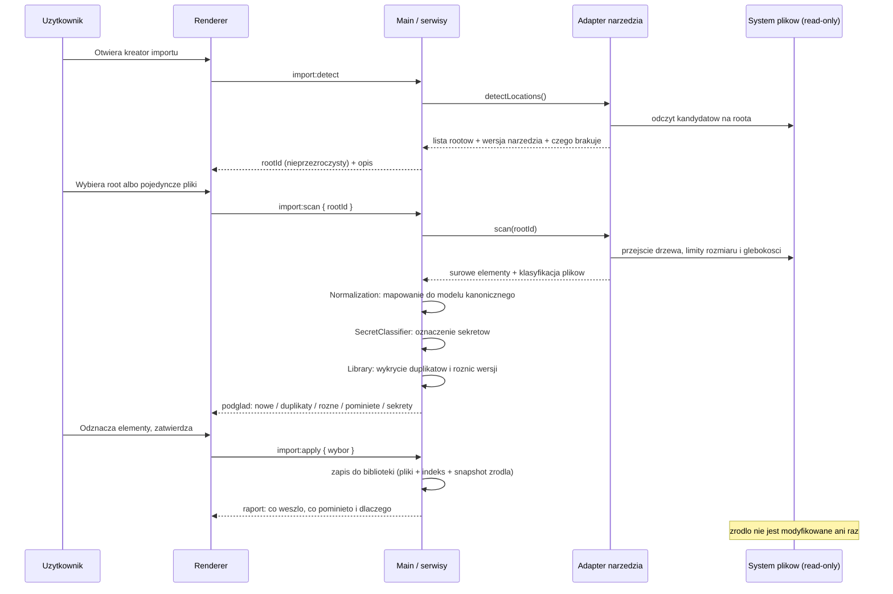
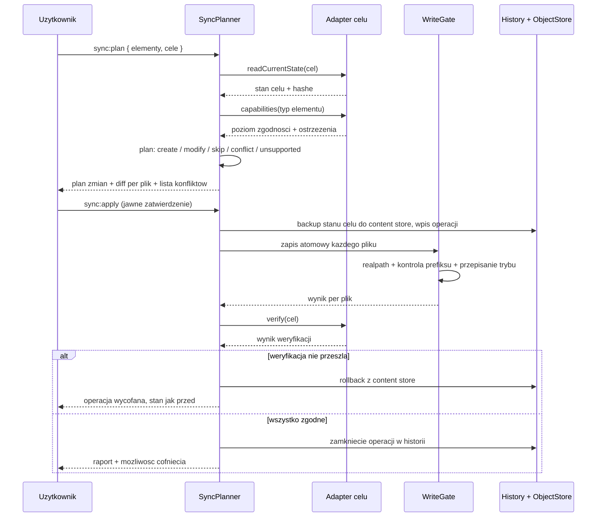
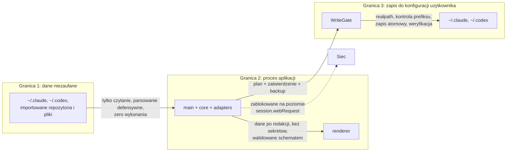

# Universal AI Skills Manager - architektura

Dokument Etapu 0. Odnosi się do `docs/00-wymagania-zrodlowe.md` i go nie zastępuje: wymagania
mówią co i dlaczego, ten dokument mówi jak i gdzie, z uzasadnieniem każdej decyzji i jej kosztem.
Decyzje mają swoje rekordy w `docs/adr/`. Plan etapów, struktura katalogów i ryzyka są
w `docs/ROADMAP.md`.

Stan: projekt nie istnieje. Nie powstał żaden szkielet, nie zainstalowano żadnej zależności,
nie wykonano żadnej operacji gitowej. Dokument czeka na akceptację właściciela produktu.

---

## 1. Stan wyjściowy (audyt)

### 1.1 Repozytorium

Katalog projektu zawiera wyłącznie
`docs/00-wymagania-zrodlowe.md` (215 linii) i pusty `docs/adr/`. Brak `package.json`, brak
historii gitowej, brak CI, brak kodu.

### 1.2 Środowisko (maszyna właściciela, 2026-10-20)

| Narzędzie | Wersja | Uwaga |
|---|---|---|
| Node.js | 24.14.1 | build będzie przypięty do linii LTS, nie do 24 |
| npm | 11.14.1 | pnpm nie jest zainstalowany |
| Python | 3.14.4 | używany dziś przez testy generatora do walidacji TOML (`tomllib`) |
| git | 2.53.0 | |
| Claude Code | 2.1.303 | |
| codex-cli | 0.158.0 | |

Docker nie jest potrzebny i nie wchodzi do stacku: aplikacja desktopowa bez backendu nie ma
czego konteneryzować, a build trzech platform idzie przez runnery GitHub Actions.

### 1.3 Formaty obu narzędzi, potwierdzone odczytem

Wszystko poniżej zostało sprawdzone na żywym drzewie, tylko do czytania. Liczby to stan
z 2026-10-20 i nie są wpisywane w kod aplikacji; są dowodem, że reguły mają pokrycie
w rzeczywistości.

**Claude Code (`~/.claude`, 2.1.303)**

- 24 pliki agentów w `agents/*.md`. Wszystkie 24 mają we frontmatterze dokładnie ten sam
  zestaw kluczy: `name`, `description`, `model`, `color`, `memory`.
- 74 katalogi zawierające `SKILL.md`, 13 płaskich plików `*.md` bez frontmattera, 9 katalogów
  bez `SKILL.md` (`shared`, `references`, `backend`, `frontend`, `security`, `testing`,
  `devsecops`, `design-patterns`, `synced`). Te 9 to materiały referencyjne, nie skille. Reguła
  "skillem jest katalog z `SKILL.md`" rozpoznaje je poprawnie bez listy wykluczeń.
- 4 komendy w `commands/*.md`.
- Hooki w `settings.json`, zdarzenia obecne dziś: `PreToolUse`, `Stop`, `SessionStart`.
- Globalny plik wejściowy: `CLAUDE.md` (13 linii).
- MCP: `mcpServers` w `~/.claude.json` (dziś jeden wpis globalny) plus `.mcp.json` per projekt,
  z flagami `enabledMcpjsonServers` i `disabledMcpServers` per projekt w `~/.claude.json`
  (54 projekty).
- `skills/acme-install-cert` to plik bez rozszerzenia, nie katalog i nie `.md`. Taki wpis musi być
  pominięty jako skill, a nie wywalić skanowanie.

**Codex (`~/.codex`, codex-cli 0.158.0)**

- 57 plików `agents/*.toml` z kluczami `name`, `model_reasoning_effort`, `description`,
  `developer_instructions`. Każdy agent potrzebuje dodatkowo wpisu `[agents.<nazwa>]`
  w `config.toml` z `description` i `config_file`. Jeden agent to dwa miejsca.
- 154 wpisy w `skills/`, z czego 72 to symlinki. Codex czyta symlinkowane katalogi skilli.
- Skill Codeksa to wyłącznie `<nazwa>/SKILL.md` z wymaganym frontmatterem. Codex kluczuje
  skille po `name` z frontmattera, Claude po nazwie katalogu. To jest źródło kolizji przy
  aliasach i musi być w modelu, nie w komentarzu.
- Brak odpowiednika komend. Komendy mapują się na skille.
- `hooks.json` ma dziś poprawną strukturę: klucze `description` i `hooks`, w `hooks` tylko
  `SessionStart`. Klucz zdarzenia postawiony w korzeniu wywala parsowanie całego pliku
  i unieważnia wszystkie hooki po cichu.
- `config.toml`: sekcje `features`, `agents.*`, `marketplaces.*`, `plugins.*`, `mcp_servers.*`,
  `desktop`, `projects."<ścieżka>"`, `tui`, `notice.*`, `shell_environment_policy.*`.
  Sprawdzone: `[projects."..."]` trzyma wyłącznie `trust_level`. Codex nie ma MCP per projekt.
- Globalny plik wejściowy: `AGENTS.md` (14 linii).
- Codex nie rozwija zmiennych środowiskowych w `mcp_servers.*.env` i nie przekazuje środowiska
  rodzica serwerom MCP. Właściwy mechanizm to `env_vars = [ "NAZWA" ]`.

**Drugi root skilli Codeksa: rozbieżność zgłoszona w audycie i jej wyjaśnienie**

Audyt nie zobaczył `~/.agents/skills`, bo w `~/.agents` został wyłącznie `.skill-lock.json`
z 27 lipca, i zgłosił to jako niepewność. Przyczyna wyszła po audycie: katalog został usunięty
sześć godzin wcześniej, przy ujednolicaniu konfiguracji. 128 wpisów ze snapshotu z lipca
zarchiwizowano do `~/.claude/backups/agents-skills-20261020-061838.tar.gz` i katalog usunięto.

Root istniał i Codex go czytał. Dowód: dopóki istniał, w drzewie skilli Codeksa było 55
zduplikowanych nazw, każda w wersji żywej z `~/.claude` i starej z tamtego roota. Po usunięciu
duplikatów jest zero.

Potwierdzone odczytem po otrzymaniu wyjaśnienia: archiwum istnieje i ma 369 576 713 bajtów,
`~/.agents` i archiwum mają ten sam czas modyfikacji (06:19), a drzewo skilli Codeksa ma dziś
154 katalogi i zero zduplikowanych nazw. Liczby 128 i 55 pochodzą ze stanu sprzed usunięcia
i nie da się ich już zweryfikować; stan obecny jest z nimi spójny.

Decyzja: warstwa lokalizacji traktuje `~/.agents/skills` jako możliwą lokalizację, bo aktualizacja
Codeksa może go odtworzyć (ADR 0024). Sekcja 10.6 opisuje, co z tego wynika dla wykrywania
duplikatów międzyrootowych.

To zdarzenie jest argumentem architektonicznym mocniejszym, niż wyglądało w trakcie audytu:
ścieżki obu narzędzi zmieniają się szybciej niż ich dokumentacja i mogą zniknąć oraz wrócić bez
udziału użytkownika. Dlatego warstwa lokalizacji raportuje też to, czego nie znalazła, a nie
tylko to, co znalazła.

---

## 2. Wymagania przełożone na architekturę

### 2.1 Funkcjonalne

Pochodzą w całości z wymagań źródłowych (sekcje "Funkcjonalności", "Moduły", "Interfejs").
Przekładają się na dwanaście modułów z sekcji 6 i na jedenaście widoków z sekcji 13.

### 2.2 Niefunkcjonalne, z których wynikają konkretne decyzje

| Wymaganie | Konsekwencja architektoniczna |
|---|---|
| Dane zostają na komputerze, brak backendu | Zero połączeń sieciowych wychodzących. Blokada na poziomie `session.webRequest`, nie na poziomie obietnicy (ADR 0008) |
| Aplikacja nie nadpisuje po cichu | Każdy zapis przez `WriteGate`: plan, zatwierdzenie, backup, zapis atomowy, weryfikacja (ADR 0012) |
| Import i synchronizacja odwracalne | Content-addressed store plus log operacji; rollback nie wymaga Gita (ADR 0019) |
| Treść importowana jest niezaufana | Nic nie jest wykonywane. Zakaz `child_process` w `core/` i `adapters/` wymuszony lintem (ADR 0008) |
| Konwersja jawna i testowalna | Poziom zgodności jest polem modelu, nie opinią w UI (ADR 0013) |
| Nowe narzędzia bez przepisywania aplikacji | Jeden kontrakt adaptera plus wspólny zestaw testów kontraktowych (ADR 0013) |
| Trzy platformy | Wykrywanie lokalizacji, tryb materializacji, uprawnienia, wielkość liter i końce linii to osobne, testowalne warstwy (ADR 0015 do 0018, 0022) |
| Dostępność i klawiatura | Design system z fokusem i rolami od pierwszego komponentu, nie w Etapie 8 |

### 2.3 Czego świadomie nie ma

Backendu, kont, bazy w chmurze, mikroserwisów, telemetrii, automatycznej synchronizacji MCP
(ADR 0020), autoaktualizacji w MVP (bez podpisu nie przejdzie na macOS, ADR 0003).

---

## 3. Architektura systemu

### 3.1 Styl

Hexagonal (porty i adaptery) wewnątrz jednego procesu, bez warstwy sieciowej. Dobór nie jest
estetyczny: wymagania mówią "każde narzędzie obsługiwane przez osobny adapter" i "nowe narzędzia
dodawane przez rozszerzalną architekturę". To jest definicja portu i adaptera. Dodatkowo cała
wartość produktu siedzi w logice konwersji, która musi być testowalna bez Electrona i bez
dotykania dysku, więc domena nie może zależeć od infrastruktury.

Koszt: więcej plików i jedna warstwa interfejsów do utrzymania niż przy prostym podziale
na moduły. Przy dwóch adapterach to koszt widoczny, przy trzecim się zwraca.

Czego nie robimy: mikroserwisów (wymagania to wykluczają), Event Sourcingu dla historii (log
operacji plus content store daje to samo przy ułamku złożoności), CQRS (jeden użytkownik,
jeden proces).

### 3.2 Warstwy i reguła zależności

```
renderer (Angular)  ->  preload (contextBridge)  ->  main (IPC)  ->  core/services
                                                                       |
                                                        core/ports <---+
                                                             ^
                                              +--------------+--------------+
                                              |                             |
                                        adapters/*                      infra/*
```

Reguła: `core/` nie importuje `electron`, `node:fs`, `better-sqlite3` ani Angulara. Zależności
idą tylko do środka. Reguła jest wymuszana lintem (`import/no-restricted-paths`), a nie dobrą
wolą, bo pierwsza osoba, która zaimportuje `fs` do serwisu domenowego, zabiera nam testowalność
całej logiki konwersji.

### 3.3 Diagram komponentów



### 3.4 Przepływ danych: import



### 3.5 Przepływ danych: synchronizacja



---

## 4. Model kanoniczny

### 4.1 Zasada

Model kanoniczny nie jest częścią wspólną obu narzędzi i nie jest ich sumą. Jest zbiorem pojęć
produktu plus pamięcią tego, czego pojęcia nie objęły. Trzy warstwy w każdym elemencie:

1. **Semantyka** - to, co ma znaczenie niezależne od narzędzia (nazwa, opis, treść, głębokość
   rozumowania, zdarzenie hooka).
2. **Prezentacja i rozszerzenia** - to, co ma znaczenie w jednym narzędziu (`color`, `memory`
   u Claude'a).
3. **Snapshot źródła** - surowe pliki wejściowe, bajt w bajt, per narzędzie. Wymagania mówią
   wprost: "Zachować oryginalne dane źródłowe, jeżeli mogą być potrzebne do odzyskania informacji
   utraconych przy normalizacji". Bez tej warstwy każda normalizacja jest jednokierunkowa
   i nieodwracalna.

### 4.2 Element biblioteki

```ts
type ItemKind =
  | 'skill' | 'agent' | 'command'
  | 'global-instruction' | 'project-instruction' | 'rule'
  | 'hook' | 'tool-setting' | 'reference-asset';

interface LibraryItem {
  id: ItemId;                      // ULID, stabilne na zawsze
  kind: ItemKind;

  identity: {
    slug: string;                  // nazwa kanoniczna, bezpieczna na wszystkich systemach
    declaredName: string | null;    // "name" z frontmattera, jesli zrodlo je ma
    aliases: string[];             // inne nazwy, pod ktorymi element wystepowal
  };

  content: {
    title: string;
    description: string;
    descriptionOrigin: 'source' | 'derived';  // "derived" = wyliczony heurystyka
    body: string;                  // Markdown, konce linii znormalizowane do LF
  };

  attributes: {
    reasoningDepth?: 'routine' | 'deep' | 'deepest';
    presentation?: { accentColor?: string };
    memoryScope?: string;
    hook?: HookDefinition;
    toolSetting?: ToolSettingDefinition;
  };

  assets: Asset[];                 // pliki pomocnicze skilla

  source: {
    snapshots: SourceSnapshot[];   // per narzedzie, bajt w bajt
    importedFrom: { tool: ToolId; rootId: RootId; path: string; at: Timestamp };
  };

  classification: {
    scope: 'public' | 'private' | 'project';
    secretFindings: SecretFinding[];
  };

  compatibility: Record<ToolId, CompatibilityVerdict>;  // wyliczane, nie wpisywane
  syncState: Record<ToolId, SyncState>;
  version: { revision: number; contentHash: Sha256; updatedAt: Timestamp };
}

interface SourceSnapshot {
  tool: ToolId;
  files: { relPath: string; objectHash: Sha256; mode: number | null; lineEnding: 'lf' | 'crlf' | 'mixed' }[];
  unmappedKeys: { path: string; value: unknown }[];  // to, czego model nie objal
}

interface HookDefinition {
  event: 'PreToolUse' | 'PostToolUse' | 'Stop' | 'SessionStart' | 'UserPromptSubmit' | 'PermissionRequest' | string;
  matcher: string | null;
  command: string;
  pathStyle: 'absolute' | 'home-relative';  // bo rozwijanie $HOME rozni sie miedzy narzedziami
  timeoutSeconds: number | null;
}
```

Trzy pola są tu nieoczywiste i każde pochodzi z konkretnego ustalenia empirycznego:

**`identity.slug` kontra `identity.declaredName`.** Claude kluczuje skille po nazwie katalogu,
Codex po `name` z frontmattera. Alias (katalog, którego `SKILL.md` jest symlinkiem do innego)
jest u Claude'a nieszkodliwy, a w Codeksie daje dwa wpisy o tej samej nazwie. Model przechowuje
oba identyfikatory i odwzorowuje rzeczywistość wiernie: rozjechanie jest ostrzeżeniem, nie
błędem, i jest rozstrzygane osobno dla każdego celu przy eksporcie (ADR 0026). Wymuszanie
zgodności przy imporcie zablokowałoby zaimportowanie poprawnego skilla Claude'a, bo tam rozjechany
`name` jest legalny.

**`descriptionOrigin`.** 13 płaskich plików `.md` u Claude'a nie ma frontmattera, a Codex go
wymaga. Opis trzeba wtedy wyliczyć z treści. To jest dodanie informacji, której w źródle nie
było, i musi być oznaczone, bo inaczej po pierwszym round-tripie nie da się odróżnić opisu
autorskiego od zgadniętego.

**`pathStyle` w hooku.** Potwierdzone: Claude Code rozwija `$HOME` w stringu komendy hooka.
Dla Codeksa tego nie potwierdzono. Model przechowuje intencję, a adapter rozstrzyga formę:
Claude dostaje to, co było, Codex dostaje ścieżkę absolutną.

### 4.3 Poziomy zgodności

```ts
type CompatibilityLevel = 'full' | 'partial' | 'lossy' | 'unsupported';

interface CompatibilityVerdict {
  level: CompatibilityLevel;
  reasons: string[];     // tekst dla uzytkownika, nie kod bledu
  lostAttributes: string[];
  addedAttributes: string[];   // to, co adapter musi dopisac, bo cel tego wymaga
}
```

Verdykt jest wyliczany przez adapter z konkretnego elementu, a nie wpisany na sztywno per typ.
Ten sam skill może być `full` albo `lossy` w zależności od tego, czy ma frontmatter i czy jego
`declaredName` zgadza się ze slugiem.

Macierz bazowa:

| Typ elementu | Claude Code | Codex | Powód i co ginie |
|---|---|---|---|
| Skill katalogowy z frontmatterem | full | full lub lossy | `lossy`, gdy `declaredName` rozjeżdża się ze slugiem: Codex pokaże element pod inną nazwą niż Claude (ADR 0026) |
| Skill płaski bez frontmattera | full | lossy | Codex wymaga frontmattera, więc adapter dopisuje `name` i `description`. Nic nie ginie, ale coś jest dodawane (`addedAttributes`) |
| Agent | full | partial | Dwa miejsca docelowe: `agents/<name>.toml` plus wpis `[agents.<name>]`. `model` mapuje się na `model_reasoning_effort` przybliżeniem, `color` i `memory` nie mają odpowiednika i zostają w snapshotcie |
| Komenda | full | lossy | Codex nie ma pojęcia komendy. Mapujemy na skill, ginie semantyka wywołania przez `/nazwa` |
| Instrukcja globalna | partial | partial | Jeden plik na narzędzie (`CLAUDE.md`, `AGENTS.md`), więc zarządzany jest blok między markerami aplikacji, nie plik. Treść poza blokiem nie jest eksportowana ani kontrolowana (ADR 0025) |
| Instrukcja projektowa | full | partial | Po stronie Codeksa `[projects."..."]` trzyma wyłącznie `trust_level`, więc zakres projektowy jest w pliku, nie w konfiguracji |
| Hook | full | partial | Codex czyta tylko `hooks.<Zdarzenie>` i po cichu pomija nieznane zdarzenia. Adapter ostrzega, gdy zdarzenia nie ma na liście znanych Codeksowi |
| Serwer MCP | n/d | unsupported | Decyzja polityczna, nie techniczna (ADR 0020). Codex nie ma MCP per projekt, więc nie da się przenieść zakresu |
| Pliki pomocnicze skilla | full | full | Kopiowane razem z elementem |
| Pozostałe ustawienia narzędzia | unsupported | unsupported | Poza MVP |

Zasada nadrzędna z wymagań: przy `unsupported` nie udajemy konwersji. Element jest jawnie
oznaczony w planie eksportu, z powodem, i nie powstaje żaden plik.

---

## 5. Kontrakt adaptera

```ts
interface ToolAdapter {
  readonly id: ToolId;
  readonly displayName: string;

  detectLocations(env: PlatformEnv): Promise<DetectedRoot[]>;
  probeVersion(root: RootId): Promise<ToolVersionInfo>;

  scan(root: RootId, opts: ScanOptions): AsyncIterable<RawElement>;
  parse(raw: RawElement): ParseResult<ToolNativeElement>;
  toCanonical(native: ToolNativeElement): LibraryItem;

  capabilities(item: LibraryItem): CompatibilityVerdict;   // czysta, bez I/O
  plan(items: LibraryItem[], root: RootId): Promise<WritePlan>;
  apply(plan: WritePlan, gate: WriteGate): Promise<ApplyReport>;
  verify(plan: WritePlan, root: RootId): Promise<VerifyReport>;

  readonly materialization: MaterializationSupport;  // symlink / junction / copy
}
```

Sześć własności kontraktu, każda z uzasadnieniem:

**`plan` jest oddzielone od `apply`.** Wymagania mówią "wyświetlić plan zmian" przed zapisem
i "nie nadpisywać po cichu". Plan jest wartością, którą można pokazać, zserializować, porównać
i przetestować bez dotykania dysku. To również jedyny sposób, żeby test idempotencji był tani:
`plan` po `apply` musi być pusty.

**`apply` dostaje `WriteGate` z zewnątrz, a nie trzyma własnego `fs`.** Adapter nie może zapisać
niczego poza bramką. Dzięki temu kontrola ścieżek, backup i zapis atomowy są w jednym miejscu
i nie da się ich pominąć przez pomyłkę w nowym adapterze.

**`capabilities` zwraca verdykt, nie boolean.** Wymagania wymieniają cztery poziomy zgodności.
Boolean by je spłaszczył i wymusił zgadywanie w UI. Funkcja jest czysta i synchroniczna, bez
dostępu do dysku: dzięki temu zestaw testów kontraktowych działa bez systemu plików, a interfejs
wylicza verdykt dla całej listy bez I/O. Ta czystość jest powodem, dla którego możliwość
zrobienia kopii nie jest piątym stopniem tego verdyktu, tylko osobną własnością planu (niżej).

**`plan` ustala `recoverability` dla każdego dotykanego pliku.** Plan sonduje odczytem, czy
aplikacja jest w stanie zabezpieczyć kopią każdy plik, którego dotknie, i oznacza wpis jako
`recoverable` albo `blocked` z powodem. Plan z choćby jednym wpisem `blocked` nie jest
wykonywalny: `apply` odmawia uruchomienia, zamiast wykonać część i stanąć (ADR 0028).

**`verify` jest częścią kontraktu, nie dodatkiem.** "Zweryfikować rezultat" jest w wymaganiach
synchronizacji. Weryfikacja czyta cel z powrotem i porównuje z planem; dopiero jej wynik zamyka
operację albo uruchamia rollback.

**`materialization` jest deklarowane.** Czy element jedzie symlinkiem, junction czy kopią, to
nie szczegół implementacyjny, bo od tego zależy, czy edycja źródła propaguje się sama (ADR 0015).
Interfejs pokazuje aktywny tryb, więc adapter musi go zadeklarować.

### 5.1 Granice adapterów

Adapter wie wszystko o swoim narzędziu i nic o drugim. Nie zna modelu drugiego narzędzia, nie
importuje z niego typów, nie podejmuje decyzji o konwersji między narzędziami. Konwersja dzieje
się przez model kanoniczny: `toCanonical` jednego i `plan` drugiego. Nigdy bezpośrednio.

To jest najważniejsza różnica wobec istniejącego generatora, który mapuje Claude'a na Codeksa
wprost. Generator ma przez to jeden kierunek i dwa narzędzia na stałe. Aplikacja ma mieć n
narzędzi i oba kierunki.

Czego adapter nie robi: nie czyta i nie zapisuje bazy, nie zna UI, nie loguje bezpośrednio,
nie uruchamia niczego, nie sięga do sieci, nie dotyka plików poza rootem, który dostał.

---

## 6. Podział na moduły

Dwanaście modułów z wymagań, z jawnymi granicami. Wszystkie w jednym procesie, żadnego nie da
się odpytać po sieci.

| Moduł | Odpowiada za | Zależy od | Nie wolno mu |
|---|---|---|---|
| **Library** | Model kanoniczny, CRUD, wyszukiwanie, filtrowanie, walidacja, pliki powiązane | ports: IndexStore, ObjectStore, FileGateway | Znać formatów narzędzi |
| **Normalization** | Mapowanie natywne na kanoniczne i z powrotem, reguły utraty informacji, snapshoty | model | Czytać i pisać na dysku |
| **Tool adapters** | Wszystko specyficzne dla narzędzia (sekcja 5) | ports, shared parsery | Znać innych adapterów i UI |
| **Import** | Wykrywanie, skanowanie, podgląd, duplikaty, pomijanie, wykluczanie sekretów | adapters, Library, Security | Modyfikować źródła |
| **Export** | Mapowanie na format docelowy, podgląd plików, ostrzeżenia o zgodności | adapters, Library | Pisać bez planu i bramki |
| **Synchronization** | Plan operacji, konflikty, zatwierdzenie, wykonanie, weryfikacja | Export, History, Security | Usuwać bez jawnej polityki |
| **Diff and merge** | Porównywanie Markdown, JSON i TOML, scalanie, konflikty semantyczne | Normalization | Rozstrzygać konfliktu samo |
| **History and rollback** | Log operacji, wersje, przywracanie, cofanie synchronizacji | ObjectStore, IndexStore | Wymagać Gita |
| **Profiles** | Zestawy elementów, eksport zestawu do wielu celów | Library, Export, Security | Przenosić elementów prywatnych i projektowych |
| **Security** | Klasyfikacja zakresu, detekcja sekretów, redakcja, polityki zapisu, granice ścieżek | ports | Być opcjonalny |
| **Settings** | Konfiguracja aplikacji, roots, motyw, polityki domyślne | IndexStore | Trzymać sekretów |
| **Diagnostics** | Stan narzędzi, nieznane klucze, nieobsługiwane konstrukcje, raport środowiska | adapters | Naprawiać cokolwiek samo |

Moduł Security nie jest warstwą na końcu. Jego polityki są wywoływane przez Import (co nie wchodzi
do biblioteki), Diff (co nie trafia do podglądu), Export i Sync (co i gdzie wolno zapisać) oraz
logger (co nie trafia do pliku). Zdejmij go, i cztery inne moduły przestają spełniać wymagania.

---

## 7. Model procesów Electrona i granica IPC

### 7.1 Procesy

| Proces | Co robi | Czego nie ma |
|---|---|---|
| main | Cała logika domenowa, adaptery, dostęp do dysku, baza | Nic nie renderuje |
| preload | Jedyny most, jawna lista kanałów, walidacja w obie strony | Logiki domenowej |
| renderer | Angular 20 standalone z signals, SCSS, routing | `nodeIntegration` wyłączone, `contextIsolation` włączone, `sandbox` włączone, zero `fs`, zero `require` |
| worker | Skan drzewa, hashowanie, diff dużych plików | Dostępu do IPC renderera |

Ciężkie operacje idą do workera (`utilityProcess` albo `worker_threads`), bo skan drzewa rzędu
setek katalogów plus hashowanie blokowałyby main, a main obsługuje IPC. Objaw byłby taki, że
interfejs zamarza w trakcie importu, czyli dokładnie w momencie, w którym użytkownik potrzebuje
informacji o postępie.

### 7.2 Granica IPC

Wszystkie kanały to `invoke/handle` (żądanie i odpowiedź). Renderer nie wysyła zdarzeń jednostronnie
poza anulowaniem operacji. Lista jest jawna i zamknięta; brak kanału ogólnego typu `fs:read`.

| Kanał | Wejście | Wyjście |
|---|---|---|
| `library:list` | filtr, sortowanie, strona | lista elementów (bez treści) |
| `library:get` | `ItemId` | element z treścią |
| `library:save` | szkic elementu | element zapisany albo błędy walidacji |
| `library:delete` | `ItemId`, potwierdzenie | raport usunięcia |
| `import:detect` | `ToolId?` | lista `DetectedRoot` z `rootId` |
| `import:scan` | `rootId`, opcje | podgląd elementów |
| `import:plan` | wybór | plan importu |
| `import:apply` | `planId`, potwierdzenie | raport |
| `export:plan` | elementy, `ToolId`, `rootId` | `WritePlan` plus verdykty zgodności |
| `export:apply` | `planId`, potwierdzenie | raport |
| `sync:plan` | elementy, cele | plan plus konflikty |
| `sync:apply` | `planId`, potwierdzenie | raport |
| `sync:verify` | `operationId` | wynik weryfikacji |
| `diff:compute` | dwa odniesienia do treści | diff po redakcji sekretów |
| `history:list` | filtr | operacje i wersje |
| `history:rollback` | `operationId`, potwierdzenie | raport wycofania |
| `profiles:list`, `profiles:save`, `profiles:export-plan` | | |
| `settings:get`, `settings:set` | | |
| `diagnostics:report` | | raport środowiska i nieznanych konstrukcji |
| zdarzenia main do renderera | `progress`, `operation-log` | tylko postęp i log, nigdy treść pliku |

Trzy reguły tej granicy:

1. **Renderer nigdy nie przekazuje ścieżek, którym main ufa.** Lokalizacje są wykrywane w main
   i identyfikowane nieprzezroczystym `rootId`. Renderer nie zna i nie podaje ścieżek absolutnych.
   Path traversal przestaje być problemem walidacji stringów i staje się niemożliwy z definicji,
   bo nie ma kanału, który przyjąłby ścieżkę. Jedyny wyjątek to dialog wyboru pliku i katalogu,
   który otwiera main i który sam zwraca `rootId`, nie ścieżkę.
2. **Każdy ładunek jest walidowany schematem na wejściu i na wyjściu.** Renderer renderuje
   niezaufaną treść, więc traktujemy go jako potencjalnie skompromitowany.
3. **Żaden kanał nie zwraca sekretu.** Redakcja dzieje się w main, przed serializacją, a nie
   w komponencie, który "i tak tego nie pokaże".

---

## 8. Model bezpieczeństwa i granice zaufania



### 8.1 Granica 1: treść importowana

Niezaufane dane, bez wyjątku. Konkretnie:

- Nic nie jest wykonywane. Hooki i skrypty to tekst. `child_process` jest zabronione w `core/`
  i `adapters/` regułą lintu, więc naruszenie nie przejdzie code review ani CI.
- Parsowanie defensywne: limit rozmiaru pliku, limit głębokości drzewa, limit liczby elementów,
  twardy błąd z nazwą pliku zamiast cichego podstawienia wartości domyślnej. Ta ostatnia reguła
  jest wzięta wprost z generatora i sprawdziła się tam: nieznana wartość `model:` jest błędem,
  nie milczącym fallbackiem.
- Symlinki: przy imporcie rozwiązujemy `realpath` i odmawiamy wyjścia poza wybrany root.
  Symlink prowadzący do `~/.ssh` nie zostanie przeczytany tylko dlatego, że leżał w drzewie
  skilli. To ważne, bo Codex celowo czyta symlinkowane katalogi skilli, więc symlinki w tym
  drzewie są normą, nie anomalią.
- Nazwy plików: odrzucamy NUL, kontrolne, nazwy zarezerwowane Windowsa (`CON`, `PRN`, `AUX`,
  `NUL`, `COM1` do `COM9`, `LPT1` do `LPT9`), nazwy kończące się kropką lub spacją.

### 8.2 Granica 2: main kontra renderer

- `contextIsolation: true`, `nodeIntegration: false`, `sandbox: true`, `webSecurity: true`.
- CSP bez `unsafe-inline` i bez `unsafe-eval`. Angular buduje się bez eval, więc to nie boli.
- Markdown renderowany bez surowego HTML, bez `innerHTML`, z sanityzacją. Treść skilla jest
  danymi obcymi i może zawierać wstrzyknięcie.
- `shell.openExternal` tylko po whiteliście schematów (`https`), nigdy z treści importowanej
  bez potwierdzenia.
- Blokada sieci: `session.defaultSession.webRequest.onBeforeRequest` przepuszcza wyłącznie
  `file://` i wewnętrzny protokół aplikacji. Wymaganie "nie wysyłać zawartości lokalnych plików
  na zewnętrzne serwery" przestaje być obietnicą i staje się własnością, którą da się przetestować.

### 8.3 Granica 3: zapis

`WriteGate` to jedyna droga zapisu. Każdy zapis przechodzi:

0. **Warunek wstępny: kopia musi być możliwa.** Nie jest to krok, który może się nie udać,
   tylko warunek wykonania. `WriteGate` nie ma ścieżki kodu, która zapisuje bez udanej kopii
   stanu poprzedniego. Dla pliku, który dopiero powstaje, kopią jest zapis faktu nieistnienia,
   żeby rollback miał co przywrócić. Brak możliwości kopii jest wykrywany już na etapie `plan`
   i blokuje plan, a nie przerywa zapis w połowie (ADR 0028).
1. Kanonizacja ścieżki (`realpath` katalogu nadrzędnego) i kontrola, czy leży pod zadeklarowanym
   rootem celu. Na Windowsie dodatkowo odrzucenie ścieżek UNC i `\\?\`.
2. Backup dotykanego stanu do content store, z wpisem w logu operacji.
3. Zapis przez plik tymczasowy z pidem w nazwie i `rename`, z jawnym przepisaniem trybu pliku.
   To nie jest kosmetyka: `rename` daje nowy inode, więc bez przepisania trybu plik z `0600`
   wraca na `0644`. W generatorze zdegradował się tak `config.toml`, który trzymał sekret.
4. Sprzątanie pliku tymczasowego przy błędzie.
5. Weryfikacja: odczyt z powrotem i porównanie z planem.
6. Przy niepowodzeniu rollback z content store.

### 8.4 Sekrety

Trzy miejsca, w których sekret może wyciec, i trzy osobne mechanizmy:

| Miejsce | Mechanizm |
|---|---|
| Biblioteka | `SecretClassifier` oznacza element przy skanowaniu. Elementy z trafieniem są domyślnie wykluczone z importu i nie da się ich włączyć jednym kliknięciem bez jawnego potwierdzenia |
| Podgląd diffa | Redakcja w main, przed wysłaniem do renderera. Diff liczony na treści zredagowanej, nie redagowany po narysowaniu |
| Logi | Redakcja w loggerze, czyli na poziomie infrastruktury. Serwis nie może zalogować sekretu, nawet gdyby chciał |

Klasyfikator łączy cztery sygnały: nazwa i rozszerzenie pliku (`*credentials*`, `*.pem`, `*.key`,
`*.p12`, `auth.json`, `.env`), wzorce znanych kluczy (`sk-`, `ghp_`, `AKIA`, `-----BEGIN`),
entropia ciągu, oraz nazwa klucza w strukturze (`token`, `secret`, `password`, `api_key`).
Każdy sygnał daje trafienie z poziomem pewności i uzasadnieniem, bo fałszywe trafienie, którego
nie da się zrozumieć, skończy się wyłączeniem całej funkcji przez użytkownika.

Wnioski z audytu, które to potwierdzają: `~/.codex/auth.json` i `~/.codex/config.toml` to pliki,
które realnie trzymały albo trzymają dane uwierzytelniające, a leżą dokładnie w drzewie, które
aplikacja będzie skanować.

### 8.5 Uprawnienia plików na trzech systemach

`chmod 600` nie znaczy nic na Windowsie. Wymóg ochrony backupów i katalogu danych realizujemy tak:

- POSIX: katalogi `0700`, pliki `0600`, ustawiane przy tworzeniu, nie po.
- Windows: ACL ograniczony do właściciela, ustawiany jednorazowo na katalogu `userData`
  przy pierwszym uruchomieniu, przez `icacls` z weryfikacją wyniku. Jeśli ustawienie się nie
  udaje, aplikacja mówi to wprost w Diagnostics i nie twierdzi, że katalog jest chroniony.
- DPAPI nie wchodzi do MVP, bo MVP nie przechowuje sekretów. Jest w backlogu jako warunek dla
  jakiejkolwiek przyszłej funkcji, która miałaby je przechowywać (ADR 0018).

To jest uczciwa wersja tego wymagania. Nieuczciwa byłaby taka, w której wołamy `chmod` na
Windowsie, dostajemy brak efektu i pokazujemy zieloną kontrolkę.

---

## 9. Strategia przechowywania danych

```
<userData>/
  library/
    items/<itemId>/
      item.json            metadane kanoniczne
      body.md              tresc glowna
      assets/...           pliki pomocnicze
      snapshots/<tool>/... surowe zrodlo, bajt w bajt
  index.sqlite             indeks, wyszukiwanie (FTS5), log operacji, stan sync
  objects/<aa>/<sha256>    content-addressed store (wersje, backupy)
  backups/<timestamp>/     backup przed operacja destrukcyjna + MANIFEST
  logs/                    logi z redakcja
```

Dwie reguły tego układu:

**Pliki są prawdą, baza jest indeksem.** Elementy to w istocie pliki Markdown z metadanymi,
więc trzymanie ich jako BLOB-ów w SQLite utrudniłoby wszystko, co użytkownik może chcieć zrobić
poza aplikacją (podejrzeć, zacommitować, zgrepować). Baza trzyma to, co służy wyszukiwaniu
i śledzeniu stanu, i musi być odtwarzalna ze plików. Utrata `index.sqlite` kosztuje czas
przebudowy, nie dane. To jest warunek zaufania do aplikacji, która ma być jedynym miejscem
trzymania konfiguracji.

**Historia i rollback stoją na content store, nie na Gicie.** `objects/<sha256>` daje deduplikację,
porównywanie wersji i przywracanie bez żadnego zewnętrznego narzędzia. Wymagania mówią wprost:
"aplikacja nie może wymagać ręcznej obsługi Git do podstawowych operacji", a Git jako warstwa
dodatkowa jest w backlogu (ADR 0019).

Store trzyma **pełne treści każdej wersji**, nie łańcuch różnic (ADR 0027). Adresowanie hashem
daje deduplikację, więc koszt jest znikomy przy plikach tekstowych rzędu kilku kilobajtów,
a przywrócenie dowolnej wersji jest zapisem jednego obiektu, bez rekonstrukcji, która mogłaby
zawieść. Limit rozmiaru i czyszczenie są świadomie odroczone: dołożą politykę nad istniejącym
store'em, nie zmienią modelu danych. Settings pokazuje rozmiar store'u, żeby jego wzrost był
widoczny, a nie odkrywany przy braku miejsca na dysku.

SQLite przez `better-sqlite3`, nie `node:sqlite`. Uzasadnienie i koszt w ADR 0007: synchroniczne
API pasuje do main, FTS5 daje wyszukiwanie bez dodatkowej biblioteki, a cena to przebudowa modułu
natywnego dla każdej pary system plus architektura, w tym osobno macOS arm64 i x64. To przekłada
się bezpośrednio na kształt macierzy CI (sekcja 12) i jest ryzykiem R2 w roadmapie.

---

## 10. Pięć min wieloplatformowości

Każda jako jawna warstwa albo jawna zdolność, nie jako szczegół implementacyjny.

### 10.1 Tryb materializacji (symlinki na Windowsie)

Symlink na Windowsie wymaga trybu dewelopera albo uprawnień administratora. Rozstrzygnięcie:

| System | Element | Tryb |
|---|---|---|
| macOS, Linux | katalog, plik | symlink |
| Windows z uprawnieniem | katalog, plik | symlink |
| Windows bez uprawnienia | katalog | junction |
| Windows bez uprawnienia | plik | kopia |
| Dowolny, gdy link się nie uda | oba | kopia, z informacją dlaczego |

To nie jest wybór kosmetyczny. Symlink i junction oznaczają, że edycja źródła propaguje się sama
i element nigdy nie dryfuje. Kopia oznacza, że dryf jest możliwy i synchronizacja jest potrzebna
cyklicznie. Interfejs **musi** pokazywać aktywny tryb per element, bo od niego zależy odpowiedź
na pytanie "czy moja zmiana w bibliotece jest już widoczna w narzędziu". Dlatego
`materialization` jest w kontrakcie adaptera, a tryb aktywny jest polem `syncState`.

Wykrywanie zdolności: próba utworzenia symlinku w katalogu tymczasowym przy starcie, raz,
z zapamiętaniem wyniku i możliwością ponownego sprawdzenia z Diagnostics. Nie zgadujemy po
wersji systemu.

### 10.2 Wykrywanie lokalizacji konfiguracji

Osobna, testowalna warstwa `infra/platform/locations`, z tabelą kandydatów per narzędzie
i per system, a nie z `os.homedir()` rozsianym po kodzie. Katalog domowy, `%USERPROFILE%`,
`%APPDATA%` dla ustawień pomocniczych, zmienne środowiskowe nadpisujące, dodatkowe roots
z konfiguracji aplikacji. Wynik to lista `DetectedRoot` z informacją, co znaleziono, czego
brakuje i która ścieżka jest kandydatem nieistniejącym.

Tę warstwę testujemy przez podstawienie środowiska, a nie przez uruchamianie na trzech systemach.
Testy na trzech systemach w CI sprawdzają to, czego podstawić nie można: linki, uprawnienia,
wielkość liter.

### 10.3 Wielkość liter w nazwach

macOS APFS i NTFS są domyślnie nieczułe, ext4 jest czuły. Biblioteka zbudowana na Linuksie może
zawierać dwa elementy różniące się tylko wielkością liter, które na macOS i Windowsie zderzą się
w jeden plik.

Decyzja: walidator biblioteki blokuje to **przy zapisie do biblioteki**, nie przy eksporcie.
Powód jest praktyczny: przy eksporcie użytkownik ma już dwa elementy i nie ma dobrej odpowiedzi
na pytanie, który poświęcić. Przy zapisie odpowiedź jest oczywista, bo jeden z nich właśnie
powstaje. Klucz unikalności to `lower(slug)` plus typ. Ta sama reguła jest już sprawdzona
w generatorze, który kolizje po sanityzacji nazwy wykrywa i przerywa bez zapisu.

### 10.4 Końce linii

CRLF kontra LF rozjedzie każdy diff i każdą obietnicę braku zmian. Reguła:

- Biblioteka trzyma wyłącznie LF.
- Snapshot źródła zachowuje oryginał bajt w bajt i zapisuje wykryty styl (`lf`, `crlf`, `mixed`).
- Porównywanie i wykrywanie dryfu idzie na treści znormalizowanej. Plik, który różni się tylko
  końcami linii, nie jest zmianą.
- Zapis przywraca styl celu: jeśli plik docelowy istnieje i ma CRLF, piszemy CRLF. Inaczej
  pierwsza synchronizacja na Windowsie przepisałaby każdy plik w całości i pokazała użytkownikowi
  diff na wszystkim.

### 10.5 Uprawnienia

Opisane w 8.5. Dla porządku: na Windowsie ochrona przez `chmod` jest fikcją i aplikacja musi
to powiedzieć, a nie udawać.

### 10.6 Szósty przypadek, dołożony przez rozstrzygnięcie pytania o drugi root

Nie jest to mina wieloplatformowa, ale ma ten sam charakter: jedno narzędzie może mieć więcej
niż jeden root tego samego typu, a element może występować w obu. Codex ma `~/.codex/skills`
i `~/.agents/skills` (ADR 0024, sekcja 1.3).

Trzy obowiązki warstwy lokalizacji i importu:

1. Root nieistniejący jest zwracany jako kandydat z informacją, że go nie ma. Użytkownik widzi,
   gdzie aplikacja szukała, a nie tylko co znalazła.
2. Element występujący w dwóch rootach tego samego narzędzia jest raportowany jako duplikat
   międzyrootowy, z informacją, który jest aktywny. To jest realna wartość, nie higiena:
   w stanie sprzed usunięcia drugiego roota dotyczyło to 55 nazw, a użytkownik nie miał gdzie
   tego zobaczyć.
3. Pojawienie się roota, którego wcześniej nie było, jest zmianą stanu środowiska w Diagnostics,
   bo może pochodzić z aktualizacji narzędzia, a nie z działania użytkownika.

---

## 11. Edycja TOML z zachowaniem formatowania

To największe zidentyfikowane ryzyko techniczne projektu (R1 w roadmapie).

### 11.1 Problem

W ekosystemie JavaScriptu nie ma dobrego, format-zachowującego parsera TOML. `@iarna/toml`
i `smol-toml` parsują poprawnie, ale formatu i komentarzy nie zachowują. Zapis Codeksowego
`config.toml` w całości skasowałby komentarze i układ pliku, który użytkownik pisał ręcznie.
W audytowanym pliku jest 376 linii, kilkanaście sekcji obcych i komentarze w preambule.

Rust ma `toml_edit`, który ten problem rozwiązuje. Tauri został odrzucony świadomie (ADR 0001),
więc nie korzystamy z tego wyjścia.

### 11.2 Rozwiązanie w MVP: jawny port z udokumentowanym ograniczeniem

```ts
interface TomlEditor {
  /**
   * Zastepuje zarzadzany zakres (np. wszystkie bloki [agents.*] bez prefiksu
   * zastrzezonego) i zachowuje reszte pliku razem z komentarzami.
   *
   * OGRANICZENIE: segmentacja dziala na plikach o strukturze "naglowek sekcji
   * + klucze". Klucz z kropka zapisany poza swoja tabela (agents.x.y = 1
   * w preambule) oraz komentarz oddzielony od naglowka pusta linia zostaja
   * przypisane do segmentu wedlug regul segmentacji, nie wedlug semantyki TOML.
   * Zakres gwarancji jest wezszy niz "bajt w bajt".
   */
  replaceManagedSections(input: TomlEditInput): TomlEditResult;

  /** Odmawia edycji pliku zawierajacego konstrukcje poza zakresem segmentera. */
  preflight(text: string, managed: ManagedScope): PreflightVerdict;
}
```

Trzy mechanizmy zamieniają obietnicę na kontrolę:

1. **Preflight.** Przed jakąkolwiek edycją skanujemy plik na konstrukcje poza zakresem
   segmentera. Trafienie oznacza odmowę edycji z czytelnym komunikatem, a nie uszkodzony plik.
   To odwrotność tego, co robi dziś generator, który w takim wypadku zrobiłby coś niezamierzonego.
2. **Weryfikacja semantyczna po zapisie.** Wynik jest parsowany niezależnym parserem i porównywany
   z wejściem na poziomie drzewa: wszystko poza zarządzanym zakresem musi być identyczne.
   Niezgodność odrzuca zapis, zanim cokolwiek trafi na dysk. Zamiast ufać segmenterowi,
   sprawdzamy go przy każdym użyciu.
3. **Minimalizacja zarządzanego zakresu.** W `config.toml` zarządzamy wyłącznie blokami
   rejestracyjnymi agentów, które mają trzy linie. Cała treść agenta siedzi w osobnym pliku
   `agents/<name>.toml`, który piszemy w całości i gdzie problem zachowania formatu nie istnieje.
   Im mniejszy zarządzany zakres, tym mniejsza powierzchnia ryzyka.

### 11.3 Ścieżki wyjścia, gdyby ograniczenie okazało się nieakceptowalne

W kolejności od najtańszej:

1. **Pełny sidecar.** Wyprowadzić wszystko zarządzane do osobnych plików i zostawić w
   `config.toml` absolutne minimum. Dla agentów to już działa. Koszt: zależy od tego, co dane
   narzędzie pozwala wyprowadzić, i dla niektórych ustawień może być niemożliwe.
2. **`taplo` jako dołączona binarka.** Format-zachowujący edytor TOML napisany w Ruście,
   wołany jako proces potomny. Koszt: trzy binarki w paczce instalacyjnej, ich pobieranie
   w CI, weryfikacja sum kontrolnych, i wyłom w zasadzie "nic nie uruchamiamy" (ta zasada
   dotyczy treści importowanej, nie własnych narzędzi, ale wyłom trzeba nazwać).
3. **Własny parser TOML zachowujący trivię.** Pełna kontrola, koszt duży, ale zamknięty
   i policzalny: gramatyka TOML 1.0 jest niewielka i stabilna.

Decyzja o wyjściu zapada dopiero wtedy, gdy preflight zacznie odmawiać edycji na realnych
plikach użytkowników. Wcześniej byłaby to praca na zapas.

---

## 12. Strategia testowania

Wymaganie nadrzędne z wymagań źródłowych: testy obejmują rzeczywiste zachowanie, nie istnienie
komponentów. I: żadnych prawdziwych tokenów ani prywatnej konfiguracji użytkownika.

### 12.1 Poziomy

| Poziom | Czego dotyczy | Narzędzie |
|---|---|---|
| Jednostkowe | Parsery frontmattera, serializacja TOML, segmenter, mapowania, klasyfikator sekretów, normalizacja końców linii, reguły nazw | Vitest |
| Kontraktowe | Jeden zestaw testów uruchamiany przeciw **każdemu** adapterowi. Nowe narzędzie przechodzi je albo nie jest gotowe | Vitest |
| Integracyjne | Pełny przepływ import, biblioteka, eksport, synchronizacja, rollback, na syntetycznym drzewie w katalogu tymczasowym | Vitest plus prawdziwy system plików |
| Property-based | Round-trip: dla elementu z korpusu `toCanonical(parse(apply(plan(x))))` równa się `x` na poziomie modelu, z jawnymi wyjątkami tam, gdzie zgodność jest `partial` albo `lossy` | fast-check |
| E2E | Kreator importu, Sync Center, podgląd diffa, cofanie operacji, stany puste i błędy | Playwright przeciw Electronowi |
| Wieloplatformowe | Linki, uprawnienia, wielkość liter, końce linii, ścieżki ze spacjami i UTF-8 | ta sama macierz w CI na trzech systemach |

### 12.2 Izolacja: reguła przeniesiona z generatora bez zmian

Generator ma mechanizm, który działa i którego nie ma po co wymyślać od nowa. Harness testowy:

- odmawia startu, jeśli katalog bazowy testów leży w `~/.claude`, `~/.codex` albo `~/.agents`,
- odmawia startu, jeśli katalog bazowy to `$HOME`,
- liczy odcisk kontrolny plików konfiguracyjnych właściciela przed i po całym przebiegu
  i porównuje je na końcu,
- każdy test buduje własne drzewo tymczasowe i podstawia `HOME`.

W generatorze ten mechanizm jest asercją w `after()`. Przenosimy go 1:1, bo wartość jest dokładnie
taka, jak jego koszt: zero.

Zastrzeżenie, którego w Etapie 0 nie dopisałem, a które ujawnił pierwszy przebieg macierzy:
przeniesienie 1:1 dotyczy reguły, nie jej warunku. Na runnerze Windowsa harness uznał katalog
roboczy CI za żywą konfigurację i zablokował cały przebieg przed uruchomieniem jakiegokolwiek
testu. Warunek był napisany pod maszynę dewelopera, gdzie katalog domowy i katalog roboczy to
dwa różne drzewa. Reguła jest dobra, jej warunek musi znać środowisko CI. Stąd sekcja 12.5.

### 12.3 Korpus fixture'ów

Wszystkie fixture'y są pisane od zera jako syntetyczne drzewa. **Żaden nie pochodzi z prawdziwej
konfiguracji właściciela**, bo repozytorium będzie publiczne. Nazwy w stylu `acme-*`, treści bez
znaczenia, zero ścieżek do katalogu domowego autora, zero odniesień do pracodawcy, zero nazw
realnych agentów i skilli.

Z wymagań: poprawny skill, skill z plikami pomocniczymi, niepoprawne metadane, agenci w obu
formatach, konfiguracja z nieobsługiwanymi polami, duplikaty, konflikt między wersjami, brakujący
katalog, plik bez uprawnień, plik uszkodzony, potencjalny sekret, nietypowa ścieżka, przerwana
synchronizacja.

Z ustaleń empirycznych, czyli to, czego wymagania nie przewidziały:

- skill płaski `.md` zupełnie bez frontmattera,
- katalog w drzewie skilli, który skillem nie jest (brak `SKILL.md`),
- alias: dwa katalogi, których `SKILL.md` to ten sam plik przez symlink,
- element, w którym nazwa katalogu rozjeżdża się z `name` z frontmattera,
- dwa elementy różniące się tylko wielkością liter,
- plik z CRLF, który musi dać ten sam wynik co LF,
- `config.toml` z komentarzami nad sekcją, z sekcjami obcymi, z tablicą tabel i z kluczem
  z kropką poza tabelą (ten ostatni ma trafić w preflight i dostać odmowę),
- `hooks.json` z kluczem zdarzenia postawionym w korzeniu, czyli plik, który unieważnia
  wszystkie hooki po cichu,
- plik bez rozszerzenia w drzewie skilli (zaobserwowany w prawdziwym drzewie skilli; w fixture'ach `acme-install-cert`),
- symlink wyprowadzający poza wybrany root,
- agent bez wpisu rejestracyjnego i wpis rejestracyjny bez pliku agenta.

### 12.4 Osobne klasy testów

**Idempotencja.** `plan` po `apply` musi być pusty. Dotyczy importu, eksportu i synchronizacji.
Wymagania wymieniają to wprost, a generator pokazuje, dlaczego: błąd typu "co drugi raz coś się
zmienia" jest trudny do zauważenia ręcznie i trywialny do złapania testem.

**Atomowość.** Uszkodzone wejście nie zostawia częściowego stanu. Cały plan jest budowany przed
pierwszym zapisem. Test wymusza błąd w połowie zapisu (odebranie uprawnień do katalogu docelowego)
i sprawdza, że backup istnieje, że stan jest spójny i że ponowny przebieg domyka operację.

**Bezpieczeństwo.** Asercje negatywne, bo tylko takie mają sens:

- path traversal: `../`, symlink wyprowadzający, UNC i `\\?\` na Windowsie, nazwa z NUL,
  nazwa zarezerwowana Windowsa,
- sekret nie trafia do diffa: asercja na zawartości ładunku IPC, nie na tym, co widać w UI,
- sekret nie trafia do logu: asercja na zawartości pliku logu,
- zakaz sieci: próba żądania wychodzącego jest blokowana,
- zakaz wykonania: żaden adapter nie woła `child_process` (test statyczny plus reguła lintu),
- brak cichego nadpisania: zapis bez planu i bez zatwierdzenia nie przechodzi.

### 12.5 Każdy bezpiecznik ma test na ścieżce pozytywnej

Reguła projektowa, nie jednorazowa lekcja: **mechanizm ochronny musi mieć test, że przepuszcza
to, co bezpieczne, a nie tylko że blokuje to, co niebezpieczne.**

Powód jest konkretny i kosztował jeden cel macierzy. Harness izolacji miał dziewięć testów
sprawdzających, że odmawia startu w żywej konfiguracji, i ani jednego sprawdzającego, że startuje
w obcym, nieznanym środowisku. Na runnerze Windowsa odmówił, bo katalog roboczy CI wpadł pod jego
warunek, i zablokował przebieg przed pierwszym testem. Dziewięć testów negatywnych przeszło.
Żaden nie mógł tego wykryć, bo wszystkie pytały o to samo.

Bezpiecznik, który blokuje za dużo, nie jest bezpieczny, tylko niedostępny, i to na platformie,
której nie przewidziano. Reguła obowiązuje każdy mechanizm, który czemuś odmawia:

| Mechanizm | Test negatywny (ma zablokować) | Test pozytywny (ma przepuścić) |
|---|---|---|
| Harness izolacji | katalog w `~/.claude`, `~/.codex`, `~/.agents`, `$HOME` | katalog tymczasowy, katalog roboczy CI, katalog o nazwie myląco podobnej do żywej konfiguracji |
| `WriteGate`, kontrola prefiksu | `..`, symlink wyprowadzający, UNC, `\\?\`, nazwa zarezerwowana | ścieżka ze spacjami, znakami spoza ASCII, głęboko zagnieżdżona, pod symlinkiem **wewnątrz** roota |
| Preflight TOML (ADR 0011) | dotted key poza tabelą, tablica tabel w zakresie zarządzanym | `config.toml` z komentarzami, sekcjami obcymi i pustymi liniami, czyli plik realny |
| `recoverability` (ADR 0028) | plik nieczytelny, katalog tylko do czytania, cel niebędący zwykłym plikiem | plik istniejący i czytelny, plik dopiero tworzony, plik tylko do czytania w katalogu zapisywalnym |
| Klasyfikator sekretów | pliki credentials, wzorce kluczy, wysoka entropia | skill mówiący o tokenach w treści, nazwa pliku zawierająca słowo `key` w innym znaczeniu |
| Blokada sieci (ADR 0008) | żądanie do hosta zewnętrznego | `file://` i protokół aplikacji muszą działać |

Każdy wiersz tej tabeli ma dwie kolumny i obie są wymagane. Kryterium akceptacji jest proste:
żaden bezpiecznik nie wchodzi do repozytorium z samą kolumną lewą.

### 12.6 Co bierzemy z korpusu regresyjnego generatora

Generator ma 1328 linii testów i 123 przechodzące przypadki. Przenoszalna jest **metoda i część
przypadków**, nie same asercje, bo one mówią o generatorze, nie o aplikacji. Konkretnie bierzemy:
harness z podstawianym `HOME` i kanarkiem, klasy testów (atomowość, idempotencja, nienaruszalność
obcych sekcji, kody wyjścia, EACCES w połowie zapisu, CRLF równa się LF, walidacja wyniku
niezależnym parserem TOML) i scenariusze formatowe wymienione w 12.3. Nie bierzemy testów
kierunku Claude do Codeksa jako takiego, bo aplikacja nie ma tego kierunku na stałe.

---

## 13. Interfejs

### 13.1 Zasady

Z wymagań: dark mode domyślnie, jasny jako opcja, czytelna typografia, dopracowane odstępy
i hierarchia, subtelne animacje, wyraźne stany ładowania, sukcesu, ostrzeżenia i błędu, bez
zbędnych gradientów i generycznego wyglądu AI, działanie na mniejszych ekranach, dostępność
i obsługa klawiatury.

Architektonicznie oznacza to design system od Etapu 1, nie od Etapu 8: tokeny kolorów i odstępów,
dwa motywy przez zmienne CSS, komponenty bazowe z obsługą fokusu i rolami ARIA, oraz jedna
reguła organizacyjna, która ma znaczenie przy tym produkcie: **każdy stan operacji na plikach
ma swój widok**. Plan, konflikt, trwa, powodzenie, częściowe powodzenie, błąd, wycofane.
Aplikacja, która nadpisuje pliki użytkownika, nie może mieć stanu "coś się stało".

### 13.2 Widoki

Dashboard, Skills Library, Agents, Commands, Rules, Profiles, Sync Center, Diff Viewer,
Import Wizard, History, Settings, oraz Diagnostics jako trzynasty, wynikający z modułu
Diagnostics i z wymagania "nie ukrywać ograniczeń technicznych".

Kolejność dostarczania w `docs/ROADMAP.md`. Zasada z wymagań: najważniejsze przepływy muszą
rzeczywiście działać, nie tylko dashboard ma wyglądać. Praktycznie to znaczy, że Dashboard
powstaje jako jeden z ostatnich, bo agreguje to, co już działa, i bez tego pokazywałby atrapy.

### 13.3 Ikona aplikacji

Nierozstrzygnięte. Wymagania nie mówią o ikonie ani o nazwie produktu widocznej dla użytkownika,
a brief decyzji o niej nie zawiera. Potrzebne formaty, gdy decyzja zapadnie: `.icns` dla macOS,
`.ico` dla Windowsa, PNG w kilku rozmiarach dla Linuksa, plus ikona okna. Do czasu decyzji build
wychodzi z placeholderem i jest to widoczne w Diagnostics, a nie przemilczane. Pytanie dla
właściciela: sekcja 15.2, punkt 6.

---

## 14. CI/CD dla trzech platform

Lokalny build z macOS-a nie pokrywa trzech platform, więc macierz GitHub Actions nie jest
wygodą, a warunkiem (ADR 0010).

### 14.1 `ci.yml` - każdy PR i każdy push

Cztery cele: `linux-x64` (`ubuntu-latest`), `macos-arm64` (`macos-15`), `macos-x64`
(`macos-15-intel`), `windows-x64` (`windows-latest`). Node z linii LTS, przypięty. Cache npm.
Etykiety obrazów są przypięte do celów i podlegają wymianie, gdy GitHub wycofuje obraz; cele
się nie zmieniają (ADR 0010).

Kroki: lint (ESLint plus Prettier plus reguła granic modułów), typecheck (`tsc --noEmit`,
`strict` włączone), testy jednostkowe i kontraktowe, testy integracyjne, E2E Playwright
przeciw zbudowanemu Electronowi (na Linuksie pod `xvfb`), build próbny (`electron-builder --dir`),
skan sekretów (`gitleaks`) i `npm audit`.

Cztery wpisy macierzy, nie trzy, z jednego powodu: `better-sqlite3` to moduł natywny i macOS
arm64 oraz x64 to osobne cele. Gdyby macierz miała jeden wpis dla macOS, dowiedzielibyśmy się
o problemie przy pierwszym release.

### 14.2 `release.yml` - na tag `v*`

Artefakty: `dmg` i `zip` dla macOS arm64 i x64, `nsis` i wersja przenośna dla Windows x64,
`AppImage` i `deb` dla Linux x64. Publikacja jako GitHub Release z sumami `SHA256SUMS`.
Uprawnienia workflow ograniczone do `contents: write`. Żadnych sekretów w CI, bo w MVP nie ma
czego podpisywać.

### 14.3 Konsekwencje braku podpisu

Release jest niepodpisany świadomie (ADR 0003). Gatekeeper na macOS i SmartScreen na Windowsie
będą ostrzegać. Z tego wynikają trzy rzeczy, które muszą być w projekcie od początku:

1. README z jawną instrukcją obejścia dla obu systemów. Nie w FAQ, w sekcji instalacji.
2. `SHA256SUMS` w każdym release, bo bez podpisu to jedyna weryfikacja, jaką użytkownik ma.
3. Autoaktualizacja wyłączona. `electron-updater` na macOS wymaga podpisu, więc włączenie jej
   bez podpisu dałoby funkcję, która działa na jednym systemie z trzech. Pliki `latest.yml`
   generujemy od początku, żeby włączenie było później kwestią konfiguracji, nie przebudowy.

### 14.4 Ryzyko modułu natywnego w CI

`better-sqlite3` instaluje się z prebuildów przez `prebuild-install`. Dla konkretnej pary wersja
Electrona plus platforma prebuild może nie istnieć, i wtedy potrzebny jest `electron-rebuild`
oraz pełny toolchain na runnerze (Xcode CLT, MSVC Build Tools, `build-essential`). Dlatego
macierz czterech celów działa od Etapu 1, a nie od Etapu 9. Wykrycie tego problemu na trzy dni
przed wydaniem MVP byłoby najdroższym możliwym momentem.

---

## 15. Decyzje właściciela: rozstrzygnięte i wciąż otwarte

Osiem pytań z audytu Etapu 0. Cztery rozstrzygnięte 2026-10-20 i przeniesione do ADR-ów, cztery
otwarte z zapisem, który etap blokują.

### 15.1 Rozstrzygnięte

| Pytanie | Rozstrzygnięcie | ADR |
|---|---|---|
| 1. Drugi root skilli Codeksa | `~/.agents/skills` jest możliwą lokalizacją. Root istniał, Codex go czytał (55 zduplikowanych nazw), usunięto go sześć godzin przed audytem. Aktualizacja Codeksa może go odtworzyć | 0024 |
| 2. Eksport instrukcji globalnych | Aplikacja zarządza blokiem między własnymi markerami i nie dotyka reszty pliku. Brak markerów oznacza dopisanie na końcu, nigdy przepisanie. Blok bez markerów wymaga decyzji użytkownika | 0025 |
| 3. Tożsamość przy rozjechanej nazwie | Oba identyfikatory przechowywane, rozstrzygane per narzędzie przy eksporcie. Rozjechanie to ostrzeżenie, nie błąd | 0026 |
| 7. Retencja historii | Pełne treści w content store adresowanym hashem, z deduplikacją. Limit i czyszczenie świadomie odroczone, dołożą politykę, nie zmienią modelu danych | 0027 |

### 15.2 Otwarte

4. **Polityka usuwania przy synchronizacji.** *Blokuje Etap 5.* Wymagania mówią "jawna polityka
   i potwierdzenie", ale nie mówią która. Czy nigdy nie usuwamy i tylko raportujemy sieroty, czy
   usuwamy to, co aplikacja wcześniej sama utworzyła? Drugi wariant wymaga wstrzykiwania markera
   własności do plików docelowych, czyli zmienia treść eksportu i musi być zaakceptowany jawnie.
   Dotyczy też bloku instrukcji globalnej: domyślnie blok zostaje i jest raportowany jako sierota
   (ADR 0025).
5. **Zakres projektowy w MVP.** *Blokuje Etap 3.* Biblioteka ma trzymać "project instructions",
   ale Etapy 1 do 5 tego nie wyróżniają. Czy MVP obsługuje konfiguracje projektowe (`CLAUDE.md`
   i `AGENTS.md` w repozytoriach, `.mcp.json`), czy tylko globalne? To różnica w warstwie
   wykrywania lokalizacji i w modelu zakresów.
6. **Ikona i nazwa produktu.** *Nie blokuje żadnego etapu przed Etapem 10.* Czy generujemy ikonę
   przed wydaniem MVP? Jeśli tak, potrzebuję nazwy lub inicjałów na ikonę, koloru wiodącego
   i preferencji stylu. Rekomendacja, jeśli nie ma preferencji: płaski monogram w jednym kolorze.
   Skaluje się od 16 na 16 do rozmiarów desktopowych bez przerysowywania, podczas gdy ikona
   ilustracyjna wygląda lepiej w dużym rozmiarze, ale gubi detal w małym i wymaga więcej iteracji.
   Jeśli odpowiedź to nie, MVP wychodzi z placeholderem i zostaje to zapisane, żeby nie wracało
   jako pytanie.
8. **Tworzenie drzewa narzędzia od zera.** *Blokuje Etap 4.* Czy aplikacja ma prawo utworzyć
   `~/.codex/skills` na maszynie, gdzie Codeksa nie ma, czy odmawia eksportu, dopóki narzędzie
   nie jest zainstalowane? Generator odmawia. Dla aplikacji to decyzja produktowa, nie techniczna.

---

## 16. Odniesienie do wymagań źródłowych

| Wymaganie źródłowe | Gdzie zrealizowane |
|---|---|
| Założenia 1 do 3 (lokalna aplikacja, dane u użytkownika, brak backendu) | Sekcja 3, 8.2 (blokada sieci), ADR 0001 |
| Założenie 4 (biblioteka niezależna od formatu) | Sekcja 4 |
| Założenie 5 (adapter per narzędzie) | Sekcja 5, ADR 0013 |
| Założenie 6 (konwersja jawna, testowalna, możliwie bezstratna) | Sekcja 4.3, 12.1 (testy kontraktowe i round-trip) |
| Założenie 7 (brak cichego nadpisywania) | Sekcja 8.3, ADR 0012 |
| Założenie 8 (import i sync bezpieczne i odwracalne) | Sekcja 3.5, 9, ADR 0019 |
| Założenie 9 (funkcje z rzeczywistych formatów) | Sekcja 1.3, 12.3 |
| Założenie 10 (nowe narzędzia bez przepisywania) | Sekcja 5, testy kontraktowe |
| Centralna biblioteka, metadane | Sekcja 4.2, 9 |
| Import, rozróżnianie struktury i zasobów | Sekcja 3.4, 4.3, 12.3 |
| Eksport z podsumowaniem zmian | Sekcja 5 (`plan` oddzielone od `apply`) |
| Synchronizacja z planem i weryfikacją | Sekcja 3.5 |
| Scalanie i porównywanie | Moduł Diff and merge, sekcja 6 |
| Historia i wersjonowanie | Sekcja 9, ADR 0019 i 0027 |
| Profile i zestawy | Moduł Profiles, sekcja 6 |
| 12 modułów | Sekcja 6 |
| Model kanoniczny i poziomy zgodności | Sekcja 4 |
| Bezpieczeństwo (16 punktów) | Sekcja 8 |
| Brak automatycznej synchronizacji MCP | ADR 0020 |
| Interfejs i widoki | Sekcja 13 |
| Centralna biblioteka: instrukcje globalne i projektowe | Sekcja 4.3, ADR 0025 |
| Etapy 0 do 10 | `docs/ROADMAP.md` |
| Strategia testowania | Sekcja 12 |
| Zasady pracy (16 punktów) | Przestrzegane w tym dokumencie; zasady 10, 11 i 12 dały sekcję 15 i rozbieżność w 1.3 |
